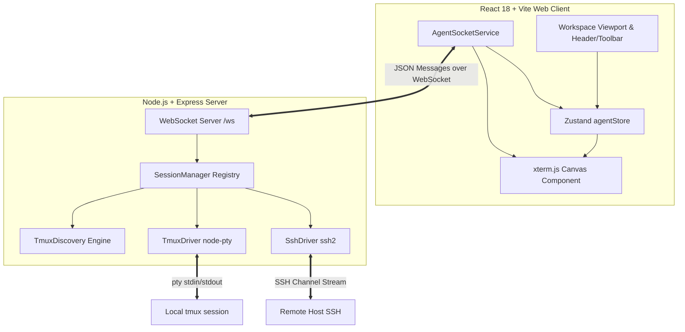
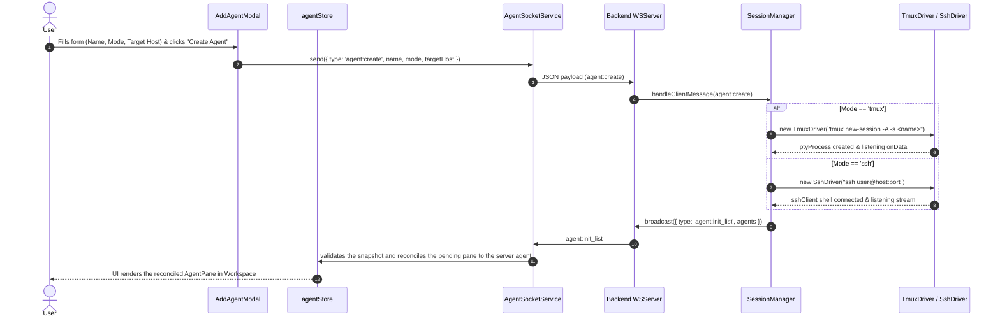
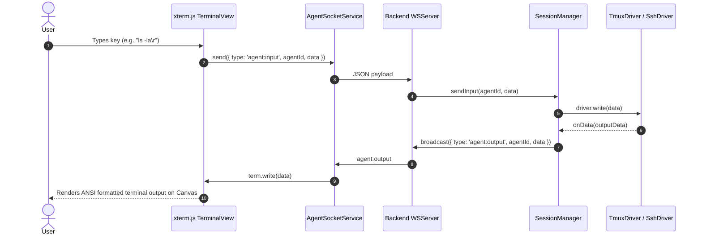

# AI Agent Manager System Architecture

This document provides a comprehensive technical overview of the **AI Agent Manager** architecture, data flow, communication protocol, and internal component design.

---

## 1. System High-Level Topology

The system uses a decoupled client-server architecture:
- **Frontend (Client)**: React 18 SPA rendering terminal instances using `@xterm/xterm` canvas renderer inside absolute-positioned window panes. Managed by a central Zustand state store.
- **Backend (Server)**: Node.js Express server + WebSocket endpoint (`ws://localhost:8088/ws`). Maintains active pseudo-terminals (`node-pty`) attached to local `tmux` sessions or remote `ssh2` shell streams.



---

## 2. Sequence Diagrams

### 2.1 Agent Creation & Session Attachment



**Roster reconciliation.** The gateway assigns agent ids and announces creates, kills and new connections as a full `agent:init_list` snapshot. The frontend replaces its roster by id while keeping each pane's layout, and matches a pending create to the new agent by name, mode and targetHost. Phase 6 replaces this with `reqId` acks and `agent:added/removed` messages.

### 2.2 Terminal Stream IO Flow (Input & Output)



---

## 3. Frontend Architecture

### 3.1 Directory Structure
- `src/components/agent/AgentPane.tsx`: Window frame container wrapping terminal header, control bar, and canvas view.
- `src/components/agent/TerminalView.tsx`: Manages xterm.js lifecycle, canvas fitting via `@xterm/addon-fit`, web links addon, and socket event subscriptions. It lets the registered global chords (`Ctrl/Cmd+K`, `Ctrl/Cmd+Shift+F`, `Ctrl/Cmd+/`) bypass xterm through `attachCustomKeyEventHandler` (every other key still reaches the program), names the xterm textarea `Terminal input: <agent name>`, and focuses itself on a `terminal:<id>` focus request.
- `src/components/layout/FloatingPane.tsx`: Absolute-positioned window container providing header drag handles, bottom-right resize handles, and z-index elevation.
- `src/components/layout/Workspace.tsx`: Workspace canvas rendering active panes with auto-arrange layout algorithms.
- `src/store/agentStore.ts`: Zustand application store handling state mutations, layout calculations, and subscriber notifications.
- `src/services/agentSocket.ts`: A thin singleton shim exposing `subscribe`, `send` and `reconnect` over a `BackendAdapter`: `WsAdapter` (on top of `Transport`) for the live backend, or `MockAdapter` in explicit Demo mode. There is no automatic mock fallback.
- `src/services/transport/Transport.ts`: WebSocket transport with capped, jittered exponential-backoff reconnect and a heartbeat.
- `src/services/adapters/`: `WsAdapter` (live) and `MockAdapter` (Demo mode) implementing the `BackendAdapter` contract.
- `src/store/connectionStore.ts`: Zustand store holding the backend mode (live or demo) and connection snapshot (state, attempt, next retry, last error).
- `src/components/layout/ConnectionStatusChip.tsx`: Header chip showing the true connection state or `DEMO`.
- `src/components/layout/ConnectionBanner.tsx`: Global banner for Demo mode, reconnecting (countdown and Retry now), disconnected (Reconnect) and auth failure. Gateway variables are documented in [server/README.md](../server/README.md).
- `src/components/layout/BroadcastBar.tsx`: Toolbar command bar that fans one command out to all, filtered, or selected agents via `agent:broadcast`, gating destructive patterns behind a confirmation modal.
- `src/components/layout/GlobalSearchModal.tsx`: Cross-agent log search (plain text or regex, `Ctrl+Shift+F`) over the buffered output, with jump-to-pane navigation.
- `src/components/layout/NotificationToastManager.tsx`: Subscribes to `agent:status_change` and shows toasts when an agent becomes `error` or `disconnected`.
- `src/store/uiStore.ts`: Zustand store for UI state shared across components: one overlay slot (`palette`, `help`, `search`, `addAgent`, only one open at a time), the broadcast bar flag, and focus requests (`requestFocus(target)` with a nonce) consumed by `useFocusRequest`.
- `src/keyboard/shortcuts.ts`: The single shortcut registry (`SHORTCUTS`), the global chord matcher (`matchGlobalShortcut`, matched on `event.key` only) and `formatKeys`. The help overlay and [KEYBOARD.md](KEYBOARD.md) mirror it.
- `src/keyboard/hooks.ts`: `useGlobalShortcuts` (one window keydown listener driven by the registry, hosted by `Header`) and `useFocusRequest`.
- `src/keyboard/commands.ts`: Builds the command palette list from live store state (`buildCommands`) and ranks it (`filterCommands`, capped at 50). It contains no destructive command.
- `src/components/layout/CommandPalette.tsx`: `Ctrl/Cmd+K` combobox/listbox dialog reaching agents, layouts, broadcast, search and New agent.
- `src/components/layout/ShortcutHelp.tsx`: `Ctrl/Cmd+/` dialog listing every registry row grouped by group.
- `src/store/logBufferStore.ts`: Zustand store holding a bounded per-agent ring buffer of ANSI-stripped output lines (10,000 lines per agent) used by global search.

### 3.2 Layout Algorithms
The frontend store implements three layout auto-arrange functions:
1. **`arrangeGrid(width, height)`**:
   Calculates optimal column (`cols`) and row (`rows`) bounds for active agents based on container dimensions, setting `x`, `y`, `width`, and `height` to tile the screen cleanly.
2. **`arrangeCascade(width, height)`**:
   Positions windows in a staggered diagonal pattern starting at `(20, 20)` with `+35px` offsets per window.
3. **`arrangeFocus(activeId, width, height)`**:
   Allocates the left 70% of the canvas to the primary focused agent while stacking secondary agents vertically along the right 28% sidebar column.

---

## 4. Backend Architecture

### 4.1 Component Breakdown

#### `SessionManager.ts`
The WebSocket side of the gateway. It no longer owns agents or drivers.
- Maintains the connected client set (`clients: Set<WebSocket>`) and sends the `agent:init_list` snapshot on connect.
- Fans every published server event (`agent:output`, `agent:status_change`, `agent:init_list`, `agent:updated`) out to all connected clients; it is the `publish` callback of its `AgentService`.
- Maps legacy client messages (`agent:create|input|resize|kill|broadcast`) to `AgentService` calls and turns destroy refusals into `agent:error` frames through `errorFrame`. It exposes the service as a readonly `service` property.

#### `AgentService.ts`
Transport-agnostic agent operations (ADR-010). It imports no WebSocket, Express or HTTP type.
- Owns the agent registry, the driver map and the in-flight session-kill map, and exposes `initialize`, `list`, `get`, `count`, `driverOf`, `create`, `close`, `destroy`, `input`, `resize`, `broadcast` and `update`.
- Every operation that can fail in an expected way returns a `ServiceResult` (see `serviceResult.ts`); state changes leave through one injected `publish` callback.
- `close` removes an agent and never touches tmux. `destroy` is the explicit tmux session kill; its confirm gate (`confirm` must be exactly `true`) is the first statement, before any lookup, driver call or process, so no surface can skip it by calling the service.
- `create` registers an agent only after its driver was constructed (a failed start answers `BACKEND_DOWN` and announces nothing) and refuses past `LIMITS.MAX_AGENTS` with `CONFLICT`.
- Implements lazy driver attachment for sessions discovered at startup upon first client input or window resize.

#### `serviceResult.ts`
`ServiceError { code, message, retryable, agentId? }`, `ServiceResult<T>`, the `ok` and `fail` helpers and `errorFrame`, the single builder of `agent:error` frames. Every service error message is a fixed string; underlying error text goes only to the server log.

#### `TmuxDriver.ts`
Pty process wrapper built on `node-pty`.
- Spawns `tmux new-session -A -s <session_name>` with `cols` and `rows`.
- `new-session -A` automatically attaches to existing sessions if available, or creates a new session if none exists.
- Exposes `write(data)`, `resize(cols, rows)`, and `close()` handles.

#### `SshDriver.ts`
Remote PTY manager built on `ssh2`.
- Parses target host formats: `user@host:port`, `user@host`, `host:port`, `host`.
- Resolves SSH authentication automatically via `sshKeyLoader.ts`:
  1. Prefers active SSH agent socket (`SSH_AUTH_SOCK`).
  2. Falls back to default local keyfiles (`~/.ssh/id_rsa`, `~/.ssh/id_ed25519`).
- Requests an interactive PTY shell (`sshClient.shell({ term: 'xterm-256color', cols, rows })`).

#### `TmuxDiscovery.ts`
Startup auto-discovery engine.
- Runs `tmux list-sessions -F '#{session_name}'` safely using `child_process.execFile`.
- Rehydrates active tmux sessions into the agent roster at server startup.

---

## 5. WebSocket Protocol Specification

The WebSocket server listens on `/ws` using JSON-encoded message schemas defined in `server/src/protocol/wsProtocol.ts`.

WebSocket handlers are thin: they map a frame to an `AgentService` call and a `ServiceResult` back to a frame. The HTTP handlers (Phase 6) and the later MCP handler call the same service methods.

### 5.1 Client to Server Messages (`WSMessageClient`)

#### `agent:create`
Requests creation of a new agent session.
```json
{
  "type": "agent:create",
  "name": "Code Refactor Agent",
  "mode": "tmux",
  "targetHost": "localhost:dev_session",
  "initialCmd": "htop\r"
}
```

#### `agent:input`
Sends terminal stdin data.
```json
{
  "type": "agent:input",
  "agentId": "agent-1723700000000",
  "data": "ls -la\r"
}
```

#### `agent:resize`
Notifies backend of terminal dimensions change.
```json
{
  "type": "agent:resize",
  "agentId": "agent-1723700000000",
  "cols": 120,
  "rows": 36
}
```

#### `agent:kill`
Closes an agent: the gateway detaches its pty and removes it from the roster (one `agent:init_list`). Closing
**leaves the tmux session running**.
```json
{
  "type": "agent:kill",
  "agentId": "agent-1723700000000"
}
```

To also end the tmux session, send `killSession: true` together with `confirm: true`:
```json
{
  "type": "agent:kill",
  "agentId": "agent-1723700000000",
  "killSession": true,
  "confirm": true
}
```
The gateway, not the browser, enforces the gate: `killSession` without `confirm` exactly `true` is refused with
an `agent:error` (`USAGE`) sent to the requesting client only, and nothing runs. Only tmux agents the gateway
created or discovered can be killed (non-tmux agents get `UNSUPPORTED`, an unkillable session name gets `USAGE`,
a tmux failure gets `INTERNAL`). The session name is derived server-side and the kill uses
`tmux kill-session -t =<name>` through `execFile` with an argument array, never a shell. A session that is
already gone counts as success.

#### `agent:broadcast`
Fans a single input payload out to several agents. The server writes `data` to the driver of each agent listed in `targetAgentIds`.
```json
{
  "type": "agent:broadcast",
  "targetAgentIds": ["tmux-dev_session", "tmux-qa_a"],
  "data": "echo hello\r"
}
```

---

### 5.2 Server to Client Messages (`WSMessageServer`)

#### `agent:init_list`
Initial or updated agent roster sent upon connection or agent creation/removal.
Clients treat it as an idempotent full snapshot.
```json
{
  "type": "agent:init_list",
  "agents": [
    {
      "id": "tmux-dev_session",
      "name": "Tmux: dev_session",
      "mode": "tmux",
      "targetHost": "localhost:dev_session",
      "status": "running",
      "unreadOutput": false,
      "layout": { "isFloating": false },
      "createdAt": 1723700000000,
      "lastActivity": 1723700000000
    }
  ]
}
```

#### `agent:output`
Streams stdout/stderr data from PTY or SSH stream.
```json
{
  "type": "agent:output",
  "agentId": "tmux-dev_session",
  "data": "\u001b[32m[task]\u001b[0m context sync completed.\r\n"
}
```

#### `agent:status_change`
Notifies client of agent status transition (`idle` | `running` | `thinking` | `error` | `disconnected`).
```json
{
  "type": "agent:status_change",
  "agentId": "tmux-dev_session",
  "status": "disconnected"
}
```

Planned protocol additions are specified in `docs/superpowers/specs/2026-11-07-fe-be-contract.md`, which is the contract for them.
