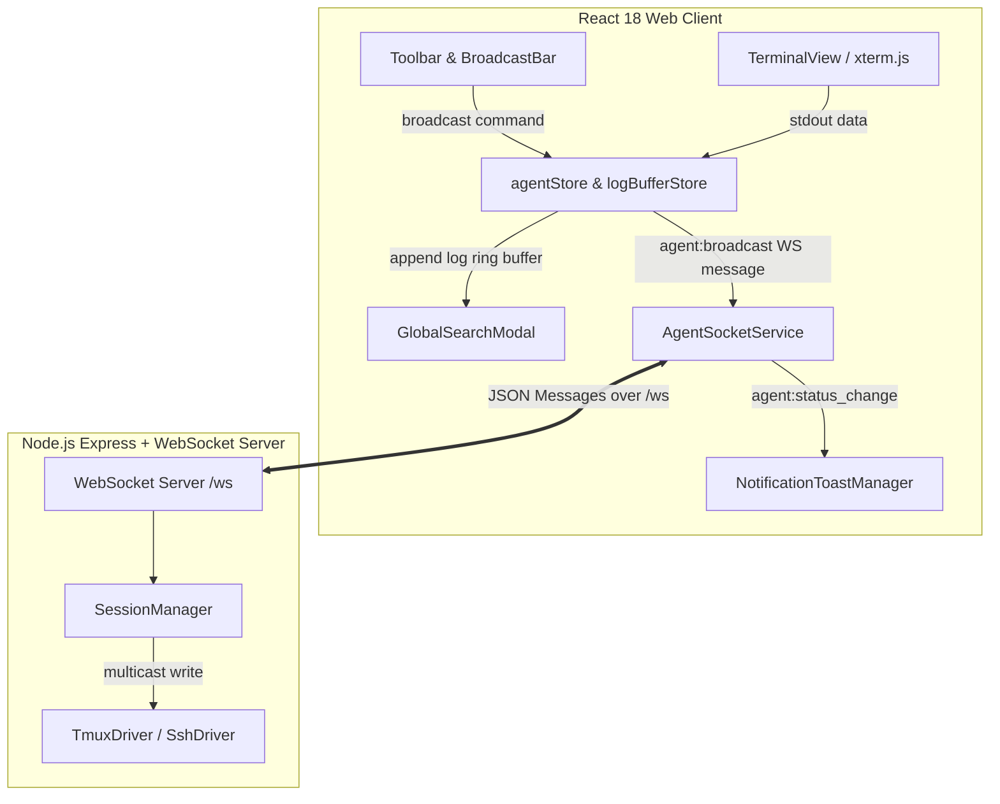

# Multi-Agent Command Fan-Out & Global Output Search Design Spec

## 1. Overview

This document specifies the design for **Multi-Agent Command Fan-Out**, **Global Output Log Search**, and **Real-Time Status Alerts** in the AI Agent Manager application. 

These features empower users managing multiple agent terminals to:
1. Broadcast command payloads to multiple or targeted agent sessions simultaneously with a safety confirmation gate.
2. Search through ANSI stdout history across all connected agents in real time with instant pane jump navigation.
3. Receive visual toast and browser notifications when an agent session encounters errors or disconnects.

---

## 2. Architecture & Data Flow



---

## 3. Protocol Extensions

### 3.1 WebSocket Message Schemas (`server/src/protocol/wsProtocol.ts`)

#### `agent:broadcast` Client Message
Sent by the frontend to broadcast terminal input data to a targeted set of agents:
```typescript
export type WSMessageClient =
  | { type: 'agent:input'; agentId: string; data: string }
  | { type: 'agent:resize'; agentId: string; cols: number; rows: number }
  | { type: 'agent:create'; name: string; mode: AgentMode; targetHost: string; initialCmd?: string }
  | { type: 'agent:kill'; agentId: string }
  | { type: 'agent:broadcast'; targetAgentIds: string[]; data: string };
```

#### Server Routing (`SessionManager.ts`)
When receiving `agent:broadcast`, `SessionManager.handleClientMessage` iterates over `msg.targetAgentIds` and invokes `sendInput(agentId, msg.data)` for each active session driver.

---

## 4. Frontend Component Specifications

### 4.1 Broadcast Bar (`BroadcastBar.tsx`)
- Integrated cleanly inside `Toolbar.tsx` as a collapsible control.
- **Target Modes**:
  - `All`: Targets all currently running agents.
  - `Filtered`: Targets agents matching the active search query or target mode.
  - `Selected`: Targets agents explicitly checked via pane selection checkboxes.
- **Safety Interceptor**:
  - Automatically intercepts commands matching regex `/rm\s|-rf|sudo|kill|drop|shutdown|reboot/i`.
  - Displays a confirmation modal showing the target agent names and requiring explicit user confirmation before dispatching.

### 4.2 Global Output Search Modal (`GlobalSearchModal.tsx`)
- Triggered via shortcut `Ctrl+Shift+F` (or `Cmd+Shift+F`) or top toolbar button.
- **Ring Buffer Store (`logBufferStore.ts`)**:
  - Maintains per-agent stdout ring buffers (bounded to 10,000 lines per agent).
- **Search Capabilities**:
  - Case-insensitive substring and regex matching across all agent stdout buffers.
  - Results group by agent with highlighted matching text and line numbers.
  - Clicking any result closes the modal, focuses the targeted agent, and scrolls to/highlights the pane.

### 4.3 Notification Toast Manager (`NotificationToastManager.tsx`)
- Listens to `agent:status_change` server events.
- Displays non-intrusive status toasts (Emerald for connected, Amber for thinking, Red for error/disconnect).
- Supports optional HTML5 Desktop Notifications if granted by the user.

---

## 5. Testing & Quality Assurance Plan

1. **Backend Integration Tests**:
   - `server/src/services/__tests__/SessionManager.test.ts`: Verify `agent:broadcast` routes input to all target drivers atomically.
   - `server/src/protocol/__tests__/wsProtocol.test.ts`: Validate `agent:broadcast` JSON schema.
2. **Frontend Unit & Component Tests**:
   - `src/components/layout/__tests__/BroadcastBar.test.tsx`: Test target filtering, command dispatching, and safety modal intercept.
   - `src/components/layout/__tests__/GlobalSearchModal.test.tsx`: Test ring buffer queries and result selection navigation.
   - `src/store/__tests__/logBufferStore.test.ts`: Test ring buffer capacity bounds and line indexing.
3. **Build & Coverage Gates**:
   - 100% pass rate on all test suites (`npm test`).
   - >90% statement coverage across new files.
   - Zero TypeScript compilation errors (`tsc`).
